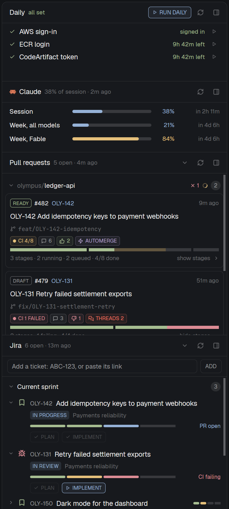
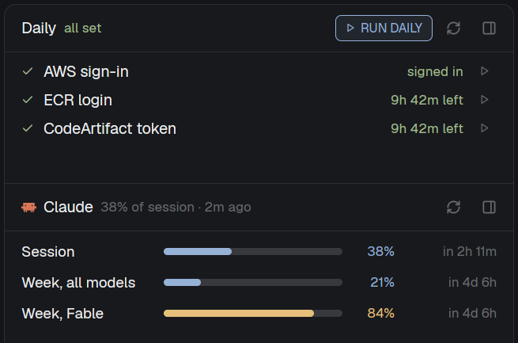
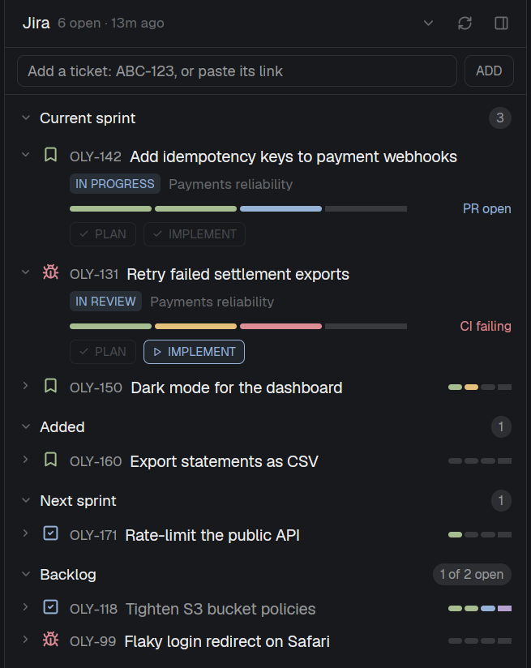

<p align="center">
  
</p>

<h1 align="center">HERMES</h1>

<p align="center">
  <b>One panel beside my agents in <a href="https://herdr.dev">Herdr</a>, carrying everything they work with:</b><br>
  my start-of-day setup, my Claude usage, my pull requests and my Jira tickets.
</p>

<p align="center">
  
  
  
  
</p>

<p align="center">
  
</p>

> Hermes carried messages for the gods. This one carries them between my agents, GitHub, Jira, AWS and Claude, and never fetches anything until I ask.

## ✨ Features

| | Section | What it does |
|---|---|---|
| 🌅 | **Daily** | My start-of-day setup as buttons: AWS sign-in, Docker login to ECR, CodeArtifact token. Each step counts down until it expires. |
| 📊 | **Claude** | My Claude plan usage, as `/usage` shows it: session, week, per-model limits, each with when it resets. |
| 🔀 | **Pull requests** | Every open PR of mine, grouped by repository, with CI, reviews, threads, conflicts and a pipeline bar. |
| 🎫 | **Jira** | My sprint, next sprint and backlog, each ticket with a plan → implement → PR → merged progress bar and buttons that start the work. |
| 🗂️ | **One panel** | All four stacked in one framed column, folding to a slim rail of icons and counts. |
| 🔒 | **Safe by design** | No secret ever reaches the panel's code. Nothing runs, fetches or refreshes until you press a button. |

### 🌅 Daily

What my `daily` shell function does, without the terminal.

- **RUN DAILY** signs in to AWS SSO, then logs Docker in to ECR and writes a fresh CodeArtifact token to `~/.gradle/gradle.properties`, side by side.
- **▶ on a step** runs just that step, signing in first if it's needed.
- **Countdowns.** The ECR login and the token each show how long they have left (12 hours from when they were made).
- **Cancel.** If the browser sign-in fails or is closed, **CANCEL** stops the waiting sign-in, so a run never hangs for its 10 minutes. It only stops a sign-in the panel started, never one in a terminal.

### 📊 Claude



- **Session**, **week (all models)** and **any model's own weekly limit**, each as a bar with its percentage and when it resets.
- Bars turn amber from 80% and red at 100%.
- It asks Claude Code itself (its `get_usage` request). No prompt is sent, so no model runs and it costs nothing, and the panel never touches your login.
- Reset times count down between checks. A window that has reset says so.

<br clear="right">

### 🔀 Pull requests


All my open PRs from one `gh` GraphQL search (about 2 API points), grouped by repository. Repositories start collapsed, and one button opens or closes them all.

Each PR is a card with:

- **READY / DRAFT**, number, linked ticket and branch
- **chips**: CI, 💬 comments, 👍 approvals, 👎 change requests, unresolved threads, conflicts, auto-merge
- **a pipeline bar**: one segment per workflow, sized by its checks. It opens into the stages, with their durations and every failing check linked to its log.
- **an attention line** saying what needs you
- **an agent icon** when an agent in Herdr's Agents list opened or pushed the PR. Click it to jump to that agent.

<br clear="right">

### 🎫 Jira



My tickets in the **current sprint**, the **next sprint** and the **backlog**, read through the Atlassian connector on my Claude account by a short `claude -p` run.

- **Progress bar** in four stages: plan (green when written), implementation (amber while the checklist has work left, green when done), PR (blue when open, red when CI fails) and merged (purple).
- **PLAN** and **IMPLEMENT** run `/mansour-plan` and `/mansour-implement` in the ticket's agent, or in a new Claude tab named after the ticket. The next step is highlighted, and a step that's done turns its button off.
- **Add any ticket** by its key or link, even one that isn't assigned to you. It's listed under *Added* until you remove it, and nothing changes in Jira.
- **Collapsible.** Each ticket is one line with a mini progress bar until you open it, and one button expands or collapses them all.

<br clear="right">

### 🗂️ One panel, or a rail


The panel button at the top right of any section folds the whole panel to a 44px rail. Each section keeps its icon and a count there: steps done, session used, open PRs, open tickets. Unfold it and every section gets its height back.

The panel's frame, dividers and rounded corners come from the layout, not the mods.

<br clear="left">

## ⌨️ Commands

Everything a button does can also be run with `herdr-app do <command>`, or bound to a key in `keys.json`.

| Command | Does |
|---|---|
| `daily-setup.run` · `.cancel` · `.check` | run everything · stop a waiting sign-in · check where each step stands |
| `claude-usage.refresh` | check Claude usage |
| `agent-prs.refresh` | load open PRs |
| `jira-tickets.refresh` | load tickets |
| `jira-tickets.expand-all` · `.collapse-all` | open or fold every ticket |
| `jira-tickets.add:<KEY>` · `.remove:<KEY>` | add or remove a ticket by hand |
| `<mod>.toggle` | fold or unfold the panel |

## 🔒 Security

- **Nothing runs by itself.** No timers and no fetches on start: network and model calls happen only when you press ↻ or a run button.
- **Secrets never reach the mods.** The ECR password and the CodeArtifact token stay in shell variables and are passed on by `printf`, a builtin. So they never appear in a process's arguments (visible in `ps`), in output, or in JavaScript.
- **The token file is safe.** It's written owner-only (600), built beside the old file and swapped in whole, so it's never half-written and a failed run leaves it untouched.
- **Claude usage needs no token.** It's read through Claude Code itself.
- **Your details stay out of the repo.** Your AWS account, Jira site, folders and repository notes live in a settings file outside it, and are only filled in on your machine.
- **Error text is cleaned.** Anything token-shaped is cut before it's shown or saved.

## 🚀 Set up

```sh
mkdir -p ~/.config/hermes
cp settings.example.json ~/.config/hermes/settings.json   # then put your own values in it
./link.sh                                   # link into ~/.config/herdr-app and ~/.claude/commands
herdr-app do layout.switch --name main-prs  # or ctrl-shift-l
```

You'll need:

- [`gh`](https://cli.github.com), signed in
- [`claude`](https://claude.com/claude-code), with the Atlassian connector connected on your Claude account
- `aws` and `docker`, for Daily
- `jq`, for `link.sh`

### ⚙️ Settings

Everything that's yours lives in `~/.config/hermes/settings.json`, never in this repo:

| Setting | Used for |
|---|---|
| `aws.profile` · `.region` · `.account` · `.codeartifact_domain` | Daily's sign-in, ECR login and CodeArtifact token |
| `jira.site` | where the Jira section looks, and the ticket links |
| `work.repos` | the folder of repositories a new ticket agent starts in, and that the commands list |
| `work.space` | the Herdr space a new ticket agent opens in |
| `work.notes` | where `/mansour-plan` writes plans and checklists, and the progress bars read them |
| `work.commit_style` | how the commands title commits and PRs |
| `commands.plan_note` · `.implement_note` | notes on your repositories for the commands, a list of lines each |

The layout and the commands are templates: `./link.sh` fills in each `{{settings.<name>}}` from this file and links the filled-in copies. A setting the file doesn't have stops it before anything changes. Leave a value empty (`""`) to go without it: a section whose settings are empty says what's missing.

Herdr keeps each section's saved state per set of layout props, so changing a setting that reaches a section (AWS or Jira) starts it fresh: press ↻ once.

## 🗺️ What's where

```
mods/
  daily-setup/     🌅 Daily: the `daily` shell function as buttons
  claude-usage/    📊 Claude: plan usage
  agent-prs/       🔀 Pull requests
  jira-tickets/    🎫 Jira
layouts/
  main-prs.json    the window: Herdr's `main` layout plus the panel (`work-side`)
claude/commands/   /mansour-plan and /mansour-implement, the commands the Jira buttons run
docs/              the logo, screenshots, and the demo layout they're taken from
settings.example.json   what ~/.config/hermes/settings.json holds
link.sh            fills in your settings and links it all where Herdr and Claude Code read it
```

## 🛠️ Editing

Edit the files here. Herdr watches its own folder, not what a link points at, so it doesn't see a save here by itself. Run `./link.sh` after saving: re-linking makes Herdr reload. Or keep `./link.sh --watch` running and it re-links on every save, the settings file's included. Commands and the layout are filled in by `./link.sh`, so an edit to one, or to your settings, needs it too.

Check a mod before calling it done:

```sh
herdr-app check mods/agent-prs
herdr-app status   # any errors
```

If something real sits where a link should be, `./link.sh` moves it to `~/.local/state/herder-customizations/backup/` and says so when it differs from this repo. That happens if Herdr rewrote the layout file itself.

Never put your own details in the repo: an account, a site, a folder or a repository name goes in the settings file, and reaches a layout or command as `{{settings.<name>}}`.

## 📸 Screenshots

The screenshots use made-up data, so no real repository, PR or ticket appears in them. Each mod has a `demo.js` (or a few lines in `main.js`) that it uses when its layout props say `demo: true`. In demo mode it shows that data and runs nothing. To retake them:

```sh
ln -s "$PWD/docs/demo/hermes-demo.json" ~/.config/herdr-app/layouts/hermes-demo.json
herdr-app do layout.switch --name hermes-demo
herdr-app shot panel.png
herdr-app do layout.switch --name main-prs
rm ~/.config/herdr-app/layouts/hermes-demo.json
```

## ↩️ Undo

Remove the links:

- `~/.config/herdr-app/mods/daily-setup`
- `~/.config/herdr-app/mods/claude-usage`
- `~/.config/herdr-app/mods/agent-prs`
- `~/.config/herdr-app/mods/jira-tickets`
- `~/.config/herdr-app/layouts/main-prs.json`
- `~/.claude/commands/mansour-plan.md`
- `~/.claude/commands/mansour-implement.md`

Your settings are in `~/.config/hermes/`, and the filled-in layout and commands in `~/.local/state/herder-customizations/build/`.

To keep using the customizations without this repo, copy them back in: `cp -rL`.
