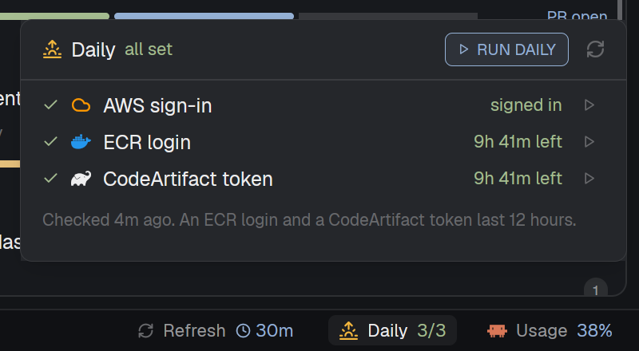
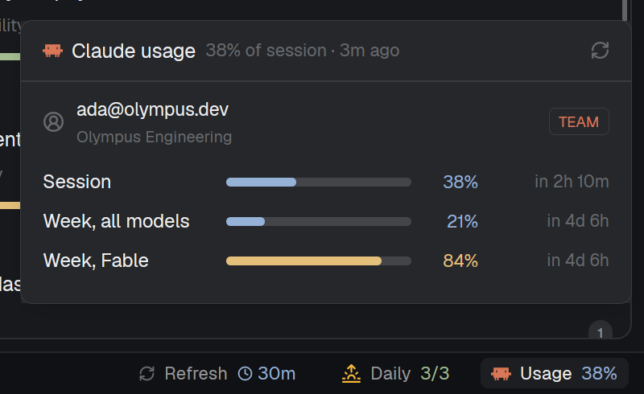
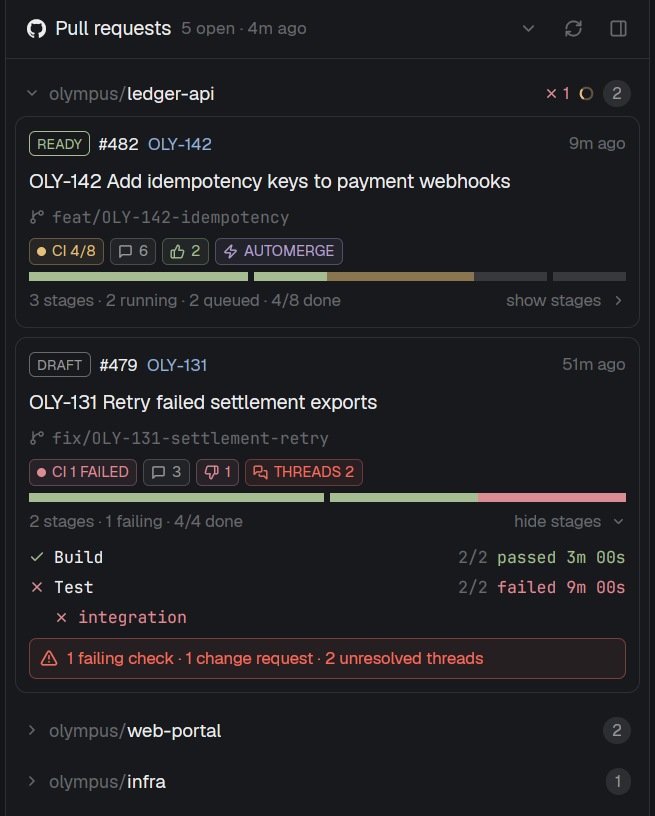
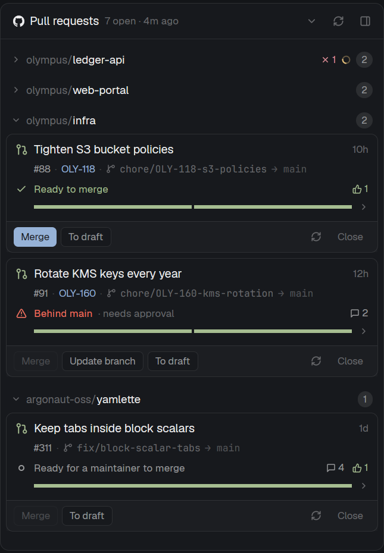
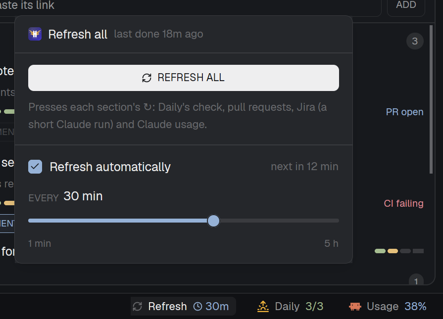

<p align="center">
  
</p>

<h1 align="center">HERMES</h1>

<p align="center">
  <b>One panel beside my agents in <a href="https://herdr.dev">Herdr</a>, carrying everything they work with:</b><br>
  my start-of-day setup, my Claude usage, my pull requests and my Jira tickets.
</p>

<p align="center">
  
  
  
  
</p>

<p align="center">
  
</p>

> Hermes carried messages for the gods. This one carries them between my agents, GitHub, Jira, AWS and Claude, and fetches nothing until I ask, or until the time I set comes round.

## ✨ Features

| | Section | What it does |
|---|---|---|
| 🌅 | **Daily** | In the window's bottom bar: how many of my start-of-day steps are set, and a click away, the steps as buttons (AWS sign-in, Docker login to ECR, CodeArtifact token), each counting down until it expires. |
| 📊 | **Claude usage** | In the window's bottom bar: the session's share at a glance, and a click away, which Claude account is signed in and its plan usage as `/usage` shows it (session, week, per-model limits, each with when it resets). |
| 🔀 | **Pull requests** | Every open PR of mine, grouped by repository: where each stands, its pipeline, and buttons to merge, mark ready, update, re-run or close it. |
| 🎫 | **Jira** | My sprint, next sprint and backlog, each ticket with a plan → implement → PR → merged progress bar and buttons that start the work. |
| 🔄 | **Refresh all** | In the window's bottom bar: one button that refreshes every section at once, and auto-refresh, off until you tick it, that does it every 1 min to 5 h. |
| 🗂️ | **One panel** | Pull requests and Jira stacked in one framed column under the HERMES bar, folding to a slim rail of icons and counts. |
| 🔒 | **Safe by design** | No secret ever reaches the panel's code. Nothing runs, fetches or refreshes until you press a button, or turn auto-refresh on. |

### 🌅 Daily



What my `daily` shell function does, without the terminal. It lives in the window's bottom bar: the sunrise, **Daily**, and how many of the three steps are set (green when all are, amber when one needs a run, red when one failed; a spinner while it works). Click it, or run `daily-setup.open`, for a popup with the steps:

- **RUN DAILY** signs in to AWS SSO, then logs Docker in to ECR and writes a fresh CodeArtifact token to `~/.gradle/gradle.properties`, side by side.
- **▶ on a step** runs just that step, signing in first if it's needed.
- **Countdowns.** The ECR login and the token each show how long they have left (12 hours from when they were made).
- **Cancel.** If the browser sign-in fails or is closed, **CANCEL** stops the waiting sign-in, so a run never hangs for its 10 minutes. It only stops a sign-in the panel started, never one in a terminal.
- **↻** checks where each step stands, and so does **REFRESH ALL**. The chip and the popup always show the same: a run keeps going, and keeps the chip up to date, with the popup closed.

<br clear="right">

### 📊 Claude usage



It lives in the window's bottom bar, at the right: the Claude mark, **Usage**, and how much of the session you've used (amber from 80%, red at 100%). Click it, or run `claude-usage.open`, for a popup with:

- **The account** Claude Code is signed in with: its email, organization and plan. Hover it for when the sign-in ends.
- **Session**, **week (all models)** and **any model's own weekly limit**, each as a bar with its percentage and when it resets.
- Bars turn amber from 80% and red at 100%.
- It asks Claude Code itself (its `get_usage` request, and `claude auth status` for the account). No prompt is sent, so no model runs and it costs nothing, and the panel never touches your login.
- Reset times count down between checks. A window that has reset says so.
- **↻** in the popup checks again, and so does **REFRESH ALL**: the chip spins while it checks, and the chip and popup show the new numbers together.

Either chip can go back in the panel as a section of its own: move its block into the `work-side` column of the layout, without the `bar` prop.

<br clear="right">

### 🔀 Pull requests



All my open PRs from one `gh` GraphQL search (about 2 API points), grouped by repository. Repositories start collapsed, and one button opens or closes them all. A repository's row shows how many of its PRs have failing checks, and a spinner while any are running.

Each PR is a card. Click it to open the PR on GitHub. It has:

- **its title**, with an open or draft icon, then its number, linked ticket and branch → base
- **where it stands**, in one line: what's in its way first (conflicts, failing checks, change requests, open threads, behind its base, needs approval, checks running, only a maintainer can merge it), or else draft, auto-merging, or ready to merge. 💬 comments, 👍 approvals and auto-merge sit at its end.
- **a pipeline bar**: one segment per workflow, sized by its checks. Click it to open the stages, with their durations and every failing check linked to its log.
- **an agent icon** when an agent in Herdr's Agents list opened or pushed the PR. Click it to jump to that agent.
- **action buttons** along its foot (see below), and **↻** beside Close, which reads just that PR again: its checks, reviews, threads, merge state and buttons, in one small query (about 1 API point), without reloading the list. If it was merged or closed meanwhile, it says so and leaves the list.

<br clear="right">

#### Acting on a PR



Each button shows only when it applies, and only when GitHub says you may use it:

- **Ready for review** on a draft, **To draft** on a PR that's ready
- **Merge**, with your usual merge method for that repository. It's on every PR that isn't a draft, but only clickable when GitHub says the PR can merge *and* you can write to its repository. Otherwise it's faded, and hovering or clicking it says why: it needs an approving review, it's behind its base, it conflicts, checks are failing or still running, or you only have read access (someone else's project).
- **Auto-merge** while it waits on reviews or checks, or **Cancel auto-merge**
- **Update branch** when it's behind its base
- **Re-run failed** when CI failed: just the failed jobs
- **Close**, quiet on the right until you hover it

The next step is filled in. Merge, Auto-merge and Close ask first, in Herdr's own dialog. Afterwards just that PR is read again, and a merged or closed one leaves the list.

<br clear="right">

### 🎫 Jira


My tickets in the **current sprint**, the **next sprint** and the **backlog**, read through the Atlassian connector on my Claude account by a short `claude -p` run.

- **Click a ticket** to open it in Jira.
- **Progress bar** in four stages: plan (green when written), implementation (amber while the checklist has work left, green when done), PR (blue when open, red when CI fails) and merged (purple). Click a stage to open its plan, its checklist or its PR.
- **PLAN** and **IMPLEMENT** run `/mansour-plan` and `/mansour-implement` in the ticket's agent, or in a new Claude tab named after the ticket. The next step is highlighted, and a step that's done turns its button off.
- **An agent icon** on a ticket that an agent's tab or space is named after. Click it to jump to that agent.
- **Add any ticket** by its key or link, even one that isn't assigned to you. It's listed under *Added* until you remove it, and nothing changes in Jira.
- **Collapsible.** Each ticket is one line with a mini progress bar until you open it, and one button expands or collapses them all.

<br clear="right">

### 🔄 Refresh all, or on a timer



It lives in the window's bottom bar, left of Daily: ↻ and **Refresh**, and, while auto-refresh is on, a clock and how often (*⏱ 30m*). Click it, or run `hermes.open`, for a popup with:

- **REFRESH ALL** presses every section's own refresh at once: pull requests, Jira (a short Claude run), Daily's check and Claude usage. Each one's ↻ (or chip) spins as if you'd clicked it, and the chip spins until the last one is done. Each ↻ still refreshes just its own. (A block elsewhere in the layout joins in by naming the panel: layout prop `"panel": "work-side"`.)
- **Refresh automatically**: tick it and Refresh all runs by itself, every so often. It's off until you tick it.
- **Every**: a slider from 1 min to 5 h, finer at the short end (to the minute up to an hour, then to 5 and 15 minutes). Letting go saves it.

Auto-refresh counts from the last Refresh all, pressed or not, and the popup says when the next one is due. A section that's still busy with its own refresh holds it back a few seconds. The setting holds across restarts; if Herdr was closed past a run, it catches up once, soon after it opens. Every run spends what a press would: a few GitHub API points, an AWS check, and a short Claude run for Jira, so a short interval spends more of your Claude plan.

<br clear="right">

### 🗂️ One panel, or a rail


The HERMES bar sits at the top. The panel button at the top right of any section folds the whole panel to a 44px rail. Each section keeps its icon and a count there: open PRs, open tickets. Unfold it and every section gets its height back.

The panel's frame, dividers and rounded corners come from the layout, not the mods.

<br clear="left">

## ⌨️ Commands

Everything a button does can also be run with `herdr-app do <command>`, or bound to a key in `keys.json`.

| Command | Does |
|---|---|
| `hermes.refresh` · `.open` · `.auto` · `.auto:on` · `.auto:off` · `.every:<minutes>` | refresh every section at once (REFRESH ALL) · open or close its popup · turn auto-refresh the other way, on or off · how often, 1 to 300 |
| `daily-setup.run` · `.step:<sso\|ecr\|codeartifact>` · `.cancel` · `.check` · `.open` | run everything · run one step · stop a waiting sign-in · check where each step stands (`.refresh` too) · open or close its popup |
| `claude-usage.refresh` · `.open` | check Claude usage · open or close its popup |
| `agent-prs.refresh` | load open PRs |
| `agent-prs.act:<action>:<number>` | press a PR's button: `ready`, `merge`, `auto-merge`, `cancel-auto-merge`, `update-branch`, `rerun-failed`, `draft`, `close`, or `refresh` (its ↻) (`owner/repo#number` if two repositories share the number). A button that's off says why, as a click on it does. |
| `jira-tickets.refresh` | load tickets |
| `jira-tickets.expand-all` · `.collapse-all` | open or fold every ticket |
| `jira-tickets.add:<KEY>` · `.remove:<KEY>` | add or remove a ticket by hand |
| `<mod>.toggle` | fold or unfold the panel |

## 🔒 Security

- **Nothing runs by itself, unless you say so.** No fetches on start, and no timers unless you tick auto-refresh (it's off until you do): network and model calls happen only when you press ↻ (a section's, or a PR's), REFRESH ALL or a run button, or when auto-refresh's time comes round.
- **Nothing changes on GitHub unless you press it.** A PR's buttons run `gh` as you, and only the ones GitHub says you may use are offered: Merge stays off unless the PR can merge and you can write to its repository. Merging, auto-merge and closing ask first.
- **Secrets never reach the mods.** The ECR password and the CodeArtifact token stay in shell variables and are passed on by `printf`, a builtin. So they never appear in a process's arguments (visible in `ps`), in output, or in JavaScript.
- **The token file is safe.** It's written owner-only (600), built beside the old file and swapped in whole, so it's never half-written and a failed run leaves it untouched.
- **Claude usage needs no token.** It's read through Claude Code itself, and of the account only the email, organization, plan and sign-in end are kept.
- **Your details stay out of the repo.** Your AWS account, Jira site, folders and repository notes live in a settings file outside it, and are only filled in on your machine.
- **Error text is cleaned.** Anything token-shaped is cut before it's shown or saved.

## 🚀 Set up

```sh
mkdir -p ~/.config/hermes
cp settings.example.json ~/.config/hermes/settings.json   # then put your own values in it
./link.sh                                   # link into ~/.config/herdr-app and ~/.claude/commands
herdr-app do layout.switch --name main-prs  # or ctrl-shift-l
```

You'll need:

- [`gh`](https://cli.github.com), signed in, and recent: Update branch runs `gh pr update-branch`, which older packages (Ubuntu 24.04's 2.45) don't have. GitHub's own apt repository keeps it current.
- [`claude`](https://claude.com/claude-code), with the Atlassian connector connected on your Claude account
- `aws` and `docker`, for Daily
- `jq`, for `link.sh`

### ⚙️ Settings

Everything that's yours lives in `~/.config/hermes/settings.json`, never in this repo:

| Setting | Used for |
|---|---|
| `aws.profile` · `.region` · `.account` · `.codeartifact_domain` | Daily's sign-in, ECR login and CodeArtifact token |
| `jira.site` | where the Jira section looks, and the ticket links |
| `work.repos` | the folder of repositories a new ticket agent starts in, and that the commands list |
| `work.space` | the Herdr space a new ticket agent opens in |
| `work.notes` | where `/mansour-plan` writes plans and checklists, and the progress bars read them |
| `work.commit_style` | how the commands title commits and PRs |
| `commands.plan_note` · `.implement_note` | notes on your repositories for the commands, a list of lines each |

The layout and the commands are templates: `./link.sh` fills in each `{{settings.<name>}}` from this file and links the filled-in copies. A setting the file doesn't have stops it before anything changes. Leave a value empty (`""`) to go without it: a section whose settings are empty says what's missing.

Herdr keeps each section's saved state per set of layout props, so changing a setting that reaches a section (AWS or Jira) starts it fresh: press ↻ once.

## 🗺️ What's where

```
mods/
  hermes/          the HERMES bar, and 🔄 Refresh all: the bottom bar's chip and its popup, with auto-refresh
  daily-setup/     🌅 Daily: the `daily` shell function as buttons, in the bottom bar's chip and its popup
  claude-usage/    📊 Claude usage: the bottom bar's chip and its popup
  agent-prs/       🔀 Pull requests
  jira-tickets/    🎫 Jira
layouts/
  main-prs.json    the window: Herdr's `main` layout plus the panel (`work-side`), and Refresh, Daily and Claude usage in the bottom bar
claude/commands/   /mansour-plan and /mansour-implement, the commands the Jira buttons run
docs/              the logo, screenshots, and the demo layout they're taken from
settings.example.json   what ~/.config/hermes/settings.json holds
link.sh            fills in your settings and links it all where Herdr and Claude Code read it
```

## 🛠️ Editing

Edit the files here. Herdr watches its own folder, not what a link points at, so it doesn't see a save here by itself. Run `./link.sh` after saving: re-linking makes Herdr reload. Or keep `./link.sh --watch` running and it re-links on every save, the settings file's included. Commands and the layout are filled in by `./link.sh`, so an edit to one, or to your settings, needs it too.

Check a mod before calling it done:

```sh
herdr-app check mods/agent-prs
herdr-app status   # any errors
```

If something real sits where a link should be, `./link.sh` moves it to `~/.local/state/herder-customizations/backup/` and says so when it differs from this repo. That happens if Herdr rewrote the layout file itself.

Never put your own details in the repo: an account, a site, a folder or a repository name goes in the settings file, and reaches a layout or command as `{{settings.<name>}}`.

## 📸 Screenshots

The screenshots use made-up data, so no real repository, PR or ticket appears in them. Each mod has a `demo.js` (or a few lines in `main.js`) that it uses when its layout props say `demo: true`. In demo mode it shows that data and runs nothing: the PR buttons and their dialog work, but only say what they would have done.

The Pull requests section has scenes, named in `mods/agent-prs/demo.js`: `demo: true` opens the CI one (checks running, a failing check in its stage list), and `demo: "merge"` the merging one (ready to merge, behind and waiting for approval, someone else's repository).

To retake them:

```sh
ln -s "$PWD/docs/demo/hermes-demo.json" ~/.config/herdr-app/layouts/hermes-demo.json
herdr-app do layout.switch --name hermes-demo
herdr-app shot panel.png
herdr-app do layout.switch --name main-prs
rm ~/.config/herdr-app/layouts/hermes-demo.json
```

For the merging scene, link a copy with that section's prop changed instead:

```sh
jq '(.. | objects | select(.id == "demo-prs") | .content.props.demo) = "merge"' \
  docs/demo/hermes-demo.json > ~/.config/herdr-app/layouts/hermes-demo.json
```

`herdr-app shot` saves the window's last frame, so keep Herdr's window showing while you take one: a hidden window keeps handing back the frame from before it was hidden. Any zoom works, since the README sets each shot's width; these were taken at 1.5 and 1.9. A chip's popup opens with its command (`herdr-app do hermes.open`, `daily-setup.open`, `claude-usage.open`) and shows in the shot; for a section taller than the window, shoot it twice with the sections sized differently and join the two at a divider.

## 🎨 Icons

- Glyphs (sunrise, cloud, ticket, refresh, …): [Lucide](https://lucide.dev), ISC.
- Brand marks: [Simple Icons](https://simpleicons.org), CC0. Jira's is in this repo; Docker, Gradle, GitHub and Claude are Herdr's own copies. Brands are their owners' trademarks. Simple Icons no longer carries an AWS mark, so the AWS sign-in shows a cloud.

## ↩️ Undo

Remove the links:

- `~/.config/herdr-app/mods/hermes`
- `~/.config/herdr-app/mods/daily-setup`
- `~/.config/herdr-app/mods/claude-usage`
- `~/.config/herdr-app/mods/agent-prs`
- `~/.config/herdr-app/mods/jira-tickets`
- `~/.config/herdr-app/layouts/main-prs.json`
- `~/.claude/commands/mansour-plan.md`
- `~/.claude/commands/mansour-implement.md`

Your settings are in `~/.config/hermes/`, and the filled-in layout and commands in `~/.local/state/herder-customizations/build/`.

To keep using the customizations without this repo, copy them back in: `cp -rL`.
